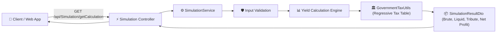

# 📈 Financial Investment Simulation Platform (CDB & Tax Engine)

[](https://dotnet.microsoft.com/)
[](https://docs.microsoft.com/en-us/dotnet/csharp/)
[](https://angular.io/)
[](https://xunit.net/)
[](https://www.docker.com/)
[](https://swagger.io/)

> **Fullstack financial investment simulation engine** designed to calculate compound interest yields on Bank Certificates of Deposit (CDB) pegged to CDI, featuring dynamic Brazilian progressive/regressive income tax calculation, rigorous unit/integration test coverage with xUnit (BDD / Data-Driven), and containerized multi-service deployment with Docker.

---

## 🏛️ Domain Architecture & Financial Logic

The core calculation simulates month-by-month compounding returns on fixed-income investments governed by Brazilian Central Bank financial parameters:

- **CDI Benchmark Rate:** Baseline reference value (e.g., 0.9% / month).
- **Bank Yield Spread (TB):** Rate paid by financial institutions (e.g., 108% of CDI).
- **Effective Monthly Yield:**  
  $$\text{Taxa Mensal} = \text{CDI} \times \left(\frac{\text{TB}}{100}\right)$$
- **Compound Accrual:**  
  $$\text{Valor Bruto}_n = \text{Valor Bruto}_{n-1} \times (1 + \text{Taxa})$$
- **Regressive Capital Gains Taxation (IR Regressivo de Renda Fixa):**
  - **Até 6 meses:** 22.5% de imposto sobre o lucro.
  - **De 7 a 12 meses:** 20.0% de imposto sobre o lucro.
  - **De 13 a 24 meses:** 17.5% de imposto sobre o lucro.
  - **Acima de 24 meses:** 15.0% de imposto sobre o lucro.



---

## 💎 Engineering Best Practices & Highlights (Senior Level)

### 1. **Robust Data-Driven Testing (xUnit Theory + BDD)**
- Fully unit-tested following the **Given-When-Then** naming convention.
- Data-driven tests (`[Theory]` + `[InlineData]`) validating edge cases, boundary inputs, negative deposits, zero periods, non-integer months, and tax bracket transitions.
- Integration tests ensuring HTTP contracts and controller serialization integrity.

### 2. **Clean Separation of Concerns**
- **Controllers:** Thin HTTP adapters with Swagger/OpenAPI documentation and unified error responses (`ProblemDetails` / `ValidationProblem`).
- **Domain Services:** Pure business rules decoupled from transport layers, using `decimal` primitives to eliminate binary floating-point precision issues.
- **Utils & Extensions:** Isolated regulatory tax tables and global exception filters.

### 3. **Single-Command Containerized Execution**
- Multi-container `docker-compose.yml` orchestrating:
  - **Backend API:** Containerized ASP.NET Core runtime (`b3-container-backend`) on port `8080`.
  - **Frontend Client:** Production-built Angular Single Page Application (`b3-container-frontend`) on port `4200`.

---

## 🚀 How to Run

### Option 1: Docker Compose (Single Command)

Navigate to the `src/` directory and spin up both backend and frontend:

```bash
cd src
docker-compose up --build
```

Access the applications:
- **Angular Web UI:** [http://localhost:4200](http://localhost:4200)
- **API Swagger Documentation:** [http://localhost:8080/swagger](http://localhost:8080/swagger)

---

### Option 2: Running via .NET CLI & npm

#### Backend:
```bash
cd src/server
dotnet restore
dotnet run
```

#### Frontend:
```bash
cd src/frontend
npm install
npm start
```

---

## 🧪 Running the Test Suite

Execute the xUnit unit and integration tests with detailed output:

```bash
cd src/tests
dotnet test --logger "console;verbosity=detailed"
```

---

## 📡 API Specification

### Endpoint: `GET /api/Simulation/getCalculation`

#### Query Parameters:
| Parameter | Type | Required | Description |
| :--- | :--- | :--- | :--- |
| `initialAmount` | `decimal` | Yes | Initial deposit amount in BRL (must be > 0). |
| `mounthQuantity` | `int` | Yes | Investment period in months (integer, >= 1). |

#### Response (`200 OK`):
```json
{
  "bruteAmount": 110.16,
  "liquidAmount": 108.13,
  "tributeAmount": 2.03,
  "tributePercent": 20.0
}
```

---

## 👨‍💻 Author

**Gustavo Reis Rocha Pitta Travnik**  
- GitHub: [@GustavoTravnik](https://github.com/GustavoTravnik)  
- Email: gustavotravnik@outlook.com
